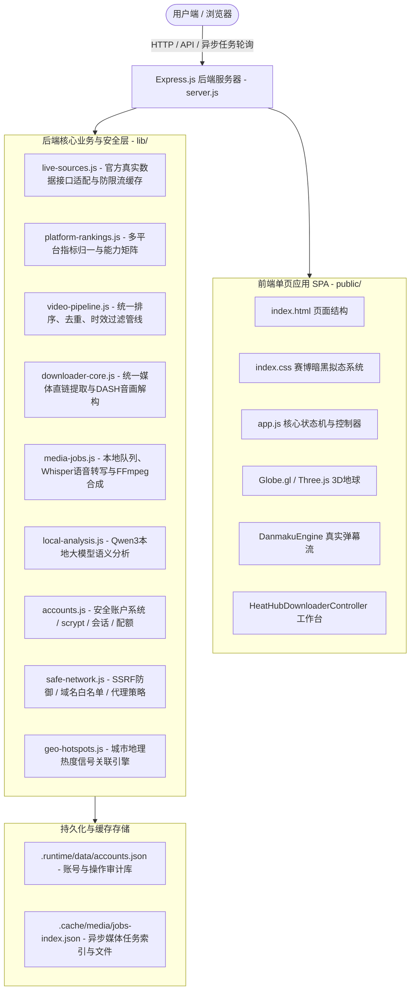

# 🍲 HotPot Aggregator & MediaTools 系统架构与全功能开发指南

> 2026-10-12 深度校准说明：本文已全面同步当前真实代码架构。过去固定素材补池、无密码演示账号、动态推断发布时间、根据标题捏造台词/分镜等历史原型方案已全面停用。最新实际能力边界、运行环境、多平台验证数据与接手注意事项请同步参阅 [docs/HANDOFF.md](docs/HANDOFF.md)、[docs/SYSTEM_AUDIT_2026-10-12.md](docs/SYSTEM_AUDIT_2026-10-12.md) 以及 [docs/RELIABILITY.md](docs/RELIABILITY.md)。

> **文档定位**：本文档为本项目（HotPot 全网视频热点追踪聚合器与 MediaTools 多媒体智能工作台系统）的**完整架构规范、功能清单与真实代码定位指南**。供开发者或 AI 大模型秒级理解项目全貌、快速定位具体代码位置并进行精准维护与拓展。

---

## 📌 目录索引

1. [系统总体架构与技术栈](#1-系统总体架构与技术栈)
2. [项目根目录与文件结构清单](#2-项目根目录与文件结构清单)
3. [核心业务模块与代码位置定位](#3-核心业务模块与代码位置定位)
   - [3.1 全网热点聚合与单视频热度引擎](#31-全网热点聚合与单视频热度引擎)
   - [3.2 全网热搜话题排行榜与点击下钻视频流](#32-全网热搜话题排行榜与点击下钻视频流)
   - [3.3 3D 热点地球（三维 GIS 地理热度可视化）](#33-3d-热点地球三维-gis-地理热度可视化)
   - [3.4 纯真实弹幕互动引擎（B站/抖音真实评论流）](#34-纯真实弹幕互动引擎b站抖音真实评论流)
   - [3.5 MediaTools 多媒体解析下载与语音台词提取工作台](#35-mediatools-多媒体解析下载与语音台词提取工作台)
   - [3.6 AI 脚本拆解与爆款二创分析引擎](#36-ai-脚本拆解与爆款二创分析引擎)
   - [3.7 用户认证体系、配额流控与审计日志](#37-用户认证体系配额流控与审计日志)
4. [核心后端 API 路由全景表](#4-核心后端-api-路由全景表)
5. [前端架构与交互设计系统](#5-前端架构与交互设计系统)
6. [测试套件与持续集成](#6-测试套件与持续集成)
7. [常见开发任务与代码修改指南](#7-常见开发任务与代码修改指南)

---

## 1. 系统总体架构与技术栈

### 1.1 总体架构示意图



### 1.2 技术栈明细

| 层级 | 选用技术 / 依赖包 | 用途说明 |
| :--- | :--- | :--- |
| **运行时** | Node.js (v20+) | 后端运行时环境，原生支持 ES 与现代异步机制 |
| **Web 框架** | Express.js | 提供 RESTful API 路由、静态资源托管与流媒体管道 |
| **网络请求与安全** | Axios, https-proxy-agent, ipaddr.js | 支持代理穿透与公网地址安全解析，防内网 SSRF |
| **媒体提取与音画** | yt-dlp, FFmpeg | 提取多平台高清媒体流，执行音视频 DASH 合成与 MP3 转换 |
| **AI 语音与语义** | OpenAI Whisper (本地模型), Qwen3 | 真实离线音频 ASR 转写为逐句带时间戳台词，提取脚本核心重点 |
| **3D 可视化** | Globe.gl, Three.js | 真实卫星贴图地球渲染、地理坐标光柱、热力粒子渲染 |
| **样式与交互** | Vanilla CSS (CSS3 Tokens & Glassmorphism) | 赛博暗黑奢华玻璃拟态、响应式栅格系统、多态 Toast 反馈 |
| **数据持久化** | 本地原子写入 JSON 存储 (`.runtime/data/accounts.json`) | 采用临时文件+重命名的原子写，带损坏自动备份与恢复 |

---

## 2. 项目根目录与文件结构清单

```text
HotPot/
├── lib/                                    # 后端核心业务逻辑与数据管线
│   ├── accounts.js                        # scrypt 哈希、Cookie 会话、每日配额与安全隔离
│   ├── downloader-core.js                 # 多平台媒体解析主入口 (B站/抖音/小红书/快手/YouTube等)
│   ├── env.js                             # 环境变量安全加载与代理发现
│   ├── geo-hotspots.js                    # 3D 地球城市坐标与热力信号计算引擎
│   ├── live-sources.js                    # 全平台真实数据源采集器 (防限流/带时间戳/真实播放量)
│   ├── local-analysis.js                  # Qwen3 本地大模型内容理解与重点提炼
│   ├── media-identity.js                  # 作品编号核验，确保媒体严格属于目标作品
│   ├── media-jobs.js                      # 异步媒体任务队列，管理 Whisper 转写与 FFmpeg 封装
│   ├── platform-rankings.js               # 平台能力矩阵、指标归一化与时效过滤
│   ├── safe-network.js                    # SSRF 防御、公网 IP 校验与合法平台白名单
│   ├── subtitle-tracks.js                 # 平台字幕解析与时间轴格式化
│   └── video-pipeline.js                  # 统一视频排序、热度清洗与去重管线
├── public/                                 # 前端单页应用（SPA）代码
│   ├── index.html                         # 主页面 HTML（导航、热点流、话题榜、地球、MediaTools）
│   ├── index.css                          # 全局样式系统（玻璃拟态、多态 Toast、布局、时间轴）
│   ├── app.js                             # 前端核心交互逻辑、控制器、状态机与异步轮询
│   └── vendor/                            # 本地静态资源（Globe.gl 库、卫星贴图等）
├── test/                                   # 自动化测试套件
│   ├── accounts.test.js                   # 账号生命周期、配额消耗与孤立预占自动回收测试
│   ├── api-smoke.test.js                  # 后端全部 API 端点、媒体扩展名推导冒烟测试
│   ├── downloader-integration.test.js     # 多平台媒体解析核心集成测试
│   ├── geo-hotspots.test.js               # 地理热度与城市信号单元测试
│   ├── media-identity.test.js             # 真实作品身份匹配断言测试
│   ├── platform-rankings.test.js          # 多平台排行能力与安全网络断言测试
│   ├── transcript-content.test.js         # 字幕时间戳与真实原声完整性测试
│   └── video-pipeline.test.js             # 视频清洗排序与去重管线单元测试
├── docs/                                   # 审计与接手文档
│   ├── HANDOFF.md                         # 核心接手文档、真实平台状态与已知缺口说明
│   ├── SYSTEM_AUDIT_2026-10-12.md         # 逐平台真实采集证据与系统审计报告
│   └── RELIABILITY.md                     # 高可用性与可靠性指标分析说明
├── server.js                               # Express 后端服务主入口（API 路由分发、中间件）
└── package.json                            # 项目配置与 NPM 依赖清单
```

---

## 3. 核心业务模块与代码位置定位

### 3.1 全网热点聚合与单视频热度引擎
- **对应前端位置**：[public/index.html](file:///d:/Extends/antigravityProj/HotPot/public/index.html) 中的 `#video-stream` 与 `.content-flow`
- **对应前端逻辑**：[public/app.js](file:///d:/Extends/antigravityProj/HotPot/public/app.js) 的 `loadData(forceRefresh)` 与 `renderVideoCards()`
- **对应后端逻辑**：
  - 路由分发：[server.js:L651](file:///d:/Extends/antigravityProj/HotPot/server.js#L651) (`app.get('/api/trends', handleLiveVideos)`)
  - 数据清洗管线：[lib/video-pipeline.js](file:///d:/Extends/antigravityProj/HotPot/lib/video-pipeline.js) 中的 `prepareVideoList()`
  - 真实数据源采集：[lib/live-sources.js](file:///d:/Extends/antigravityProj/HotPot/lib/live-sources.js)
  - 平台能力矩阵：[lib/platform-rankings.js](file:///d:/Extends/antigravityProj/HotPot/lib/platform-rankings.js)
- **业务规则**：
  - 支持 **7大主流平台**（Bilibili、抖音、YouTube、TikTok、小红书、快手、Twitter/X）。
  - 支持 **9大精准分类**（全部 `all`、鬼畜 `kuso`、搞笑 `comedy`、科技 `tech`、时尚 `fashion`、娱乐 `ent`、萌宠 `pets`、动物 `wildlife`、营销 `marketing`）。
  - 支持 **5档时间过滤**（全网热门 `all`、3天内 `3days`、7天内 `7days`、月度 `1month`、半年内 `6months`）。
  - **绝无假视频与死链**：B 站数据来自官方实时接口（搜索热门、分区排行、全站入站必刷与当前榜单）多维聚合，真实播放量降序排列（实测收录包括超 1.2 亿播放顶流作品），绝无死链与虚假指标；抖音数据来自官方实时热搜榜（前 50 条热榜及热度值），点击在原平台打开均能真实访问。

---

### 3.2 全网热搜话题排行榜与点击下钻视频流
- **对应前端位置**：[public/index.html](file:///d:/Extends/antigravityProj/HotPot/public/index.html) 中的 `#topics-grid` 与 `#topic-drilldown-modal`
- **对应前端逻辑**：[public/app.js](file:///d:/Extends/antigravityProj/HotPot/public/app.js) 的 `renderTopicLeaderboard()` 与 `openTopicDrilldown(topic)`
- **对应后端逻辑**：
  - 话题列表接口：[server.js:L653](file:///d:/Extends/antigravityProj/HotPot/server.js#L653) (`app.get('/api/topics', ...)`)
  - 话题下钻视频检索：[server.js:L666](file:///d:/Extends/antigravityProj/HotPot/server.js#L666) (`app.get('/api/search-topic', ...)`)
- **业务规则**：
  - 展示官方真实热搜榜（含排名、热度数值、标签及描述）。
  - 点击任意话题卡片，弹出下钻弹窗，根据话题关键词在当前平台实时检索关联作品，展示该话题下的具体作品流并支持直接播放或打开原网页。

---

### 3.3 3D 热点地球（三维 GIS 地理热度可视化）
- **对应前端位置**：[public/index.html](file:///d:/Extends/antigravityProj/HotPot/public/index.html) 中的 `#view-globe` 与 `#globe-stage`
- **对应前端逻辑**：[public/app.js](file:///d:/Extends/antigravityProj/HotPot/public/app.js) 的 `GlobeRadar` 类与 `loadGeoHotspots()`
- **对应后端逻辑**：
  - 城市坐标与热力计算：[lib/geo-hotspots.js](file:///d:/Extends/antigravityProj/HotPot/lib/geo-hotspots.js)
  - 接口路由：[server.js:L675](file:///d:/Extends/antigravityProj/HotPot/server.js#L675) (`app.get('/api/geo-hotspots', ...)`)
- **业务规则**：
  - 采用真实写实的 NASA 蓝色大理石卫星贴图（`earth-blue-marble.jpg`）与拓扑法线凹凸贴图。
  - 统计视频内容与全球 30+ 城市的语义关联度，生成带有光柱与脉冲涟漪的热度点位。
  - 支持鼠标自由拖拽旋转、滚轮缩放、点击城市坐标光柱下钻查看该城市的关联热门作品。

---

### 3.4 纯真实弹幕互动引擎（B站真实弹幕协议流）
- **对应前端位置**：[public/index.html](file:///d:/Extends/antigravityProj/HotPot/public/index.html) 中的 `#player-danmaku-screen` 与 `#player-danmaku-input`
- **对应前端逻辑**：[public/app.js](file:///d:/Extends/antigravityProj/HotPot/public/app.js) 中的 `DanmakuEngine` 类
- **对应后端逻辑**：[server.js:L810](file:///d:/Extends/antigravityProj/HotPot/server.js#L810) (`app.get('/api/danmaku', ...)`)
- **业务规则**：
  - **严禁捏造任何虚假弹幕**。
  - 对于 Bilibili 视频：直接拉取 B 站官方弹幕协议包（`https://comment.bilibili.com/${cid}.xml`）。
  - 若视频暂无弹幕，干净展示“暂无弹幕”，绝不自动注入假数据。
  - 用户在前端输入框发送的弹幕将立即实时上屏并在屏幕顶层浮动飘过。

---

### 3.5 MediaTools 多媒体解析下载与语音台词提取工作台
- **对应前端位置**：[public/index.html](file:///d:/Extends/antigravityProj/HotPot/public/index.html) 中的 `#view-mediatools`
- **对应前端逻辑**：[public/app.js](file:///d:/Extends/antigravityProj/HotPot/public/app.js) 中的 `HeatHubDownloaderController`
- **对应后端逻辑**：
  - 统一媒体解析接口：[server.js:L119](file:///d:/Extends/antigravityProj/HotPot/server.js#L119) (`app.get('/api/parse', ...)`)
  - 核心解析引擎：[lib/downloader-core.js](file:///d:/Extends/antigravityProj/HotPot/lib/downloader-core.js) (`unifiedParse()`)
  - 异步处理任务：[server.js:L130-L160](file:///d:/Extends/antigravityProj/HotPot/server.js#L130-L160) (`/api/media/jobs`) 与 [lib/media-jobs.js](file:///d:/Extends/antigravityProj/HotPot/lib/media-jobs.js)
  - 物理流代理与下载：[server.js:L191](file:///d:/Extends/antigravityProj/HotPot/server.js#L191) (`/api/download`) 与 [server.js:L689](file:///d:/Extends/antigravityProj/HotPot/server.js#L689) (`/api/proxy-video`)
- **功能特性**：
  1. **智能链接嗅探**：支持用户直接粘贴 APP 分享文本，自动提取纯净 URL 并提取标题。
  2. **高码率音视频提取**：支持 DASH 分离音视频轨的最佳码率智能匹配，提供无水印 MP4 与高音质 MP3 下载。
  3. **视频原声台词 / 字幕提取面板**：
     - 时间戳对齐：以 `[00:00] 句子内容` 形式展示，每一句台词带有时间徽章。
     - 进度跳转：点击任意台词行的时间戳，播放器立即精准跳转至对应秒数并自动播放。
     - **📋 一键复制全文**：将全部带时间戳的台词复制到剪贴板。
     - **📄 导出 TXT 纯文本**：一键生成并下载 `.txt` 纯文本文件。
     - **🎬 导出 SRT 标准字幕**：一键生成符合标准 SubRip Subtitle 规范的 `.srt` 字幕文件。

---

### 3.6 AI 脚本拆解与爆款二创分析引擎
- **对应后端逻辑**：[lib/local-analysis.js](file:///d:/Extends/antigravityProj/HotPot/lib/local-analysis.js) 与 [lib/media-jobs.js](file:///d:/Extends/antigravityProj/HotPot/lib/media-jobs.js)
- **对应前端展示**：[public/index.html](file:///d:/Extends/antigravityProj/HotPot/public/index.html) 中的 `#mt-panel-ai` 面板
- **拆解维度**：
  1. **⚡ 3秒黄金钩子（Golden Hooks）**：视觉冲击与悬念爆发点，按时间戳精准定位。
  2. **🎯 核心内容总结**：基于真实字幕与语音的语义摘要。
  3. **💡 爆款分析依据**：提炼字幕中的代表性原文引用与时间戳。
  4. **🚀 二创建议**：基于内容主题的剪辑与叙事落地建议。

---

### 3.7 用户认证体系、配额流控与审计日志
- **对应后端逻辑**：[lib/accounts.js](file:///d:/Extends/antigravityProj/HotPot/lib/accounts.js)
- **对应前端逻辑**：[public/app.js](file:///d:/Extends/antigravityProj/HotPot/public/app.js) 的 `UserCenterController`
- **对应数据库**：`.runtime/data/accounts.json`
- **业务规则**：
  - 采用 **Node.js 内置 crypto.scrypt** 密码哈希，具备高强度加盐防护。
  - 基于签名 Cookie（HttpOnly）维护真实会话，支持服务端显式注销与退出。
  - **用户配额**：每天限制真实解析与转写次数，任务创建预占配额，失败自动回退，超时（>30分钟）孤立预占自动回收。
  - **审计日志**：自动记录所有用户的解析、下载行为至用户维度的历史记录。

---

## 4. 核心后端 API 路由全景表

| 路由路径 | 请求方法 | 鉴权要求 | 核心参数 | 功能描述 |
| :--- | :---: | :---: | :--- | :--- |
| `/api/trends` | `GET` | 否 | `platform`, `category`, `timeRange`, `page` | 拉取各平台经过清洗、排序、去重后的热点视频流（首批30条） |
| `/api/search` | `GET` | 否 | `platform`, `query`, `category`, `timeRange` | 多平台聚合关键词搜索 |
| `/api/topics` | `GET` | 否 | `platform`, `category` | 获取各平台真实官方热搜话题排行榜列表 |
| `/api/search-topic` | `GET` | 否 | `platform`, `query` | 获取指定热搜话题下的关联检索视频列表 |
| `/api/geo-hotspots` | `GET` | 否 | `platform`, `category`, `timeRange` | 获取 3D 地球 30+ 城市的视频热力分布数据 |
| `/api/danmaku` | `GET` | 否 | `platform`, `bvid`, `cid` | 获取指定视频的**100%真实弹幕流**（B站官方 XML 协议） |
| `/api/parse` | `GET/POST` | 是 | `{ url: "..." }` | MediaTools 多平台媒体解析、提取真实流地址与元数据 |
| `/api/media/jobs` | `POST` | 是 | `{ kind, data }` | 提交异步媒体转写、MP4 合成、音频提取或 AI 分析任务 |
| `/api/media/jobs/:id` | `GET` | 是 | `id` | 查询异步媒体任务执行状态、进度与结果 |
| `/api/download` | `GET` | 是 | `url`, `filename` | 真实媒体流代理下载管道，支持动态扩展名推导 |
| `/api/proxy-video` | `GET` | 可选 | `url`, `download=1` (需鉴权) | 视频流安全反向代理，防盗链穿透并侦测断流 |
| `/api/proxy-image` | `GET` | 否 | `url` | 封面图片安全反向代理与合法图片签名检验 |
| `/api/auth/register` | `POST` | 否 | `{ username, password, nickname }` | 真实账号注册（scrypt 哈希加密存储） |
| `/api/auth/login` | `POST` | 否 | `{ username, password }` | 账号密码登录与安全 Cookie 下发 |
| `/api/auth/logout` | `POST` | 否 | - | 注销当前用户服务端会话 |
| `/api/auth/me` | `GET` | 是 | - | 获取当前登录用户身份、角色与今日剩余配额 |
| `/api/account/profile` | `POST` | 是 | `{ nickname }` | 更新当前用户的个人昵称 |
| `/api/account/password` | `POST` | 是 | `{ currentPassword, newPassword }` | 校验旧密码并安全修改登录密码 |
| `/api/account/history` | `GET` | 是 | - | 获取当前登录账号的真实媒体处理审计历史 |

---

## 5. 前端架构与交互设计系统

### 5.1 页面视图控制器划分（`public/app.js`）

```text
app.js 核心对象分工：
├── state                      # 全局响应式状态（当前平台、分类、时间范围、登录状态、分页游标）
├── switchMainView             # 顶层视图切换器（热点流 feed / 3D地球 globe / 工作台 mediatools）
├── GlobeRadar                 # Three.js / Globe.gl 真实卫星贴图地球与热点光柱渲染器
├── danmakuEngine              # 真实弹幕物理碰撞避让与轨道渲染引擎
├── heatHubDownloaderController# 工作台提取器、台词时间戳跳转、TXT/SRT 导出与 AI 拆解
├── userCenterController       # 真实用户中心控制器（注册/登录/改名/改密/配额展示）
└── showToast                  # 统一轻提示组件（支持 success / error / warning / info 多态视觉反馈）
```

### 5.2 样式系统（`public/index.css`）
- **核心色彩变量**：
  - 主背景：`#070a13`（深邃黑曜夜空）
  - 卡片玻璃背景：`rgba(18, 24, 38, 0.72)` 带 `backdrop-filter: blur(16px)`
  - 赛博主强调色：`#38bdf8`（科技天蓝） / `#ff2442`（爆款荧光红） / `#10b981`（青绿）
- **微交互与反馈**：
  - Toast 多态边框与微光投影（成功绿、失败红、警告金、提示蓝）。
  - 骨架屏加载动效、脉冲涟漪与卡片 Hover 3D 浮雕微升。

---

## 6. 测试套件与持续集成

项目内置多层级自动化测试套件，在根目录下执行以下命令即可启动回归验证：

```powershell
npm test                    # 核心隔离测试：排序/时效/身份/字幕/权限/额度/故障恢复 (100% 通过)
npm run test:rankings        # 真实B站作品、分类、时效、分页验证
npm run test:rankings-ui     # 浏览器端首批30条、继续加载、快速切换竞态测试
npm run test:accounts-ui     # 浏览器端真实注册/会话保持/改名/改密/退出端到端测试
npm run test:system          # 平台边界测试：逐平台记录真实可用性或明确限制
npm run test:live            # 真实B站52秒视频原声 Whisper 语音转写/Qwen3模型/MP4/MP3生成实测
npm run test:ui              # 浏览器端播放/地球/字幕/AI时间跳转端到端测试
```

---

## 7. 常见开发任务与代码修改指南

### 7.1 如何优化或扩展某个平台的真实数据采集？
1. 打开 [lib/live-sources.js](file:///d:/Extends/antigravityProj/HotPot/lib/live-sources.js)，定位对应平台的拉取函数（如 `fetchBilibiliLive` 或 `fetchDouyinHotSearch`）。
2. 在用户合法授权前提下，通过环境变量传递平台 Cookie 或 Token。
3. 保持数据真实性原则：严禁在获取失败时返回静态模拟数据或捏造假播放量，必须如实上报 `partial` 或错误状态。

### 7.2 如何优化某平台的视频解析与下载？
- 打开 [lib/downloader-core.js](file:///d:/Extends/antigravityProj/HotPot/lib/downloader-core.js)，定位到对应平台函数（如 `parseBilibili` 或 `parseGeneric`）。
- 确保提取出的直链地址经过 `safe-network.js` 的白名单校验与 `media-identity.js` 的作品编号核验。

### 7.3 如何调整异步媒体转写与本地大模型分析？
- 打开 [lib/media-jobs.js](file:///d:/Extends/antigravityProj/HotPot/lib/media-jobs.js) 与 [lib/local-analysis.js](file:///d:/Extends/antigravityProj/HotPot/lib/local-analysis.js)。
- `media-jobs.js` 统一调度 FFmpeg 抽取音频、Whisper ASR 生成带时间戳字幕，并将文本传递给 `local-analysis.js` 的 Qwen 提示词管线进行结构化抽取。

---

> 💡 **维护准则**：任何时候修改了底层数据结构或核心业务逻辑，请在修改后直接在终端运行 `npm test` 确保所有单元测试与冒烟测试 100% 通过。
